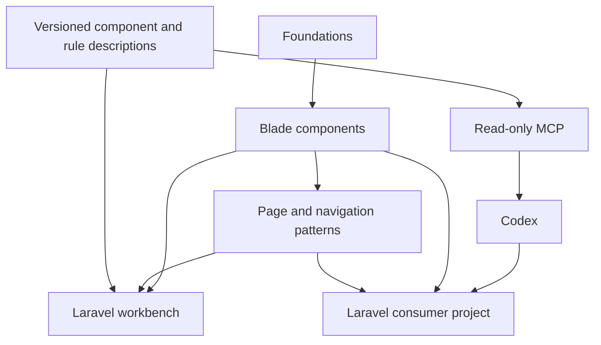

# Архитектура

## Статус

Рабочая архитектура первой реализации. Подготовлены Composer-пакет с 14 атомарными элементами, Scope/Page/Assets и Laravel-workbench. UI-выпуск 0.1.0-alpha.1 опубликован; установка из Packagist и 175 запросов рендеринга подтверждены. Полная визуальная приёмка не завершена. Исходники read-only MCP-адаптера реализованы, но его запуск и протокольная приёмка не выполнялись. Требования хранятся отдельно от решений в [журнале](decisions.md).

## Слои

| Слой | Отвечает за | Не владеет |
| --- | --- | --- |
| Foundations | Семантические токены, типографические роли, темы, плотность, состояния и layout-примитивы | Предметные данные и уникальная геометрия страницы |
| Components | Реальные Blade-компоненты, локальные стили, доступность и взаимодействие | Запросы к БД, ACL, маршрутизация приложения |
| Patterns | Оболочка, навигация, страницы, композиции форм/списков | Обязательные модели Order/User и соглашения о CRUD |
| Catalog | Назначение, правила выбора, сценарии, API и примеры одной версии | Самостоятельная копия HTML компонентов |
| Workbench | Laravel-среда живого каталога и синтетических страниц | Production-база и скрытая зависимость от референса |
| MCP | Чтение версионированных знаний и ссылок на примеры | Изменение приложения, запуск проверок и выбор за агента |
| Codex integration | Порядок поиска/выбора компонентов и соблюдения правил | Гарантия безошибочного дизайна и обход политик проекта |



## Размещение

Один самостоятельный репозиторий AesteticUi. Первоначально не нужны отдельные репозитории и пакеты для каждого слоя. Предполагаемые области будущей реализации:

```text
AesteticUi/
  AGENTS.md
  README.md
  docs/
  catalog/                 # описания, правила, сценарии, версии
  src/                     # Laravel provider, support и binding
  resources/
    views/components/
    css/
    js/
    icons/
  config/
  lang/
  dist/                    # будущая поставка готовых ассетов
  workbench/               # живой Laravel-каталог
  bin/aestetic-ui-mcp       # STDIO executable
  src/Mcp/                 # чтение снимка и SDK tools
  tools/mcp/               # инструкции и пример подключения
  tests/
```

Существуют документы, JSON-каталог, служебные файлы и дизайн-прототип в `design/reference/`. Дополнительно созданы `composer.json`, `src/` (provider и чтение manifest), `config/`, `resources/views/components/`, `resources/css/`, `dist/`, `examples/`, `tools/build-assets.php`, `catalog/examples/` и `workbench/`. Также реализованы bin/aestetic-ui-mcp, src/Mcp и tools/mcp; их запуск и подключение к клиенту не подтверждены. Остальные области дерева выше — план. Прототип не является renderer библиотеки или живым каталогом.

Workbench — локальное Laravel 12 приложение и реальный Composer path-потребитель единственного дерева пакета. Его каталог читает реестр подключённого пакета; записи `previews` задают сценарии из `catalog/examples/<id>.blade.php`. Один и тот же фрагмент рендерится Blade и показывается как исходник. Каждый preview — отдельный документ iframe, чтобы темы и Page/main не смешивались с оболочкой. Параметры темы, плотности и ширины хранятся в URL; JS, БД и отдельная frontend-сборка для этого не нужны. Planned-записи показываются как план без API и preview. Служебная оболочка каталога не считается реализацией planned-компонентов навигации/таблиц. Подробнее — [workbench/README.md](../workbench/README.md).

## Первая техническая база

- Laravel/Blade; исходная целевая среда Laravel 12 / PHP 8.3. Это стартовая граница, не подтверждённая матрица совместимости. Начиная с 0.1.0-alpha.2, Composer также допускает Laravel 13 по запросу mts33-backend; runtime-проверки этого расширения не запускались. Поддержка Laravel 12 сохраняется.
- Рабочие идентификаторы: Composer `aestetic/ui`, namespace `Aestetic\Ui`, Blade `<x-ui::button>`, CSS `.aui-*` и `--aui-*`. Доступность публичных имён не проверялась.
- Anonymous views по умолчанию; PHP-класс для самостоятельной нормализации/связывания данных. Не создавать пустой класс на каждый шаблон.
- Собственный CSS на семантических переменных; потребителю не требуется наследовать конфигурацию Tailwind. Локальный reset ограничен компонентами/областью библиотеки.
- Небольшие ES modules. Не наследовать обязательную связку Alpine/jQuery/Select2. Уникальные IDs, идемпотентная инициализация, cleanup и изоляция экземпляров.
- Единственный источник иконок — Lucide (U-11). Прототип использует локальную подборку оригинальных SVG с зафиксированным upstream commit и лицензией; будущий Blade Icon должен использовать тот же набор Lucide. Другие наборы и самодельные заменители не допускаются.
- Темы light/dark/system и обычная/компактная плотность. Клавиатурное управление и распознаваемый focus сохраняются через нейтральное изменение существующей рамки/фона или подчёркивание. Синие outline и focus-ring не добавляются, в том числе ради доступности: прямое уточнение пользователя U-14 от 23 октября 2026.
- Визуальный ориентир — shadcn/ui (U-13), с собственной реализацией для Laravel/Blade. Смысловые цвета бейджей и правила выбора описаны в [badges.md](badges.md); точные оттенки остаются рабочим дизайн-решением.
- Потребитель устанавливает Composer-пакет с готовыми CSS/JS. Источники и сборка библиотеки живут здесь. Точные build-зависимости фиксируются при каркасе, без заявления совместимости заранее.

## Доставка

Выбранный пользователем канал распространения — GitHub + Packagist (U-24, D-29). Публичный GitHub-репозиторий хранит исходники и теги выпусков; Packagist предоставляет Composer сведения о пакете и версиях. После публикации потребитель устанавливает библиотеку через `composer require <окончательное-имя-пакета>` без ручного добавления VCS-источника. Рабочее имя `aestetic/ui` ещё не подтверждено; GitHub owner/URL и лицензия выбираются перед публикацией. Совместимость ограничивается явно заявленной для выпуска матрицей PHP/Laravel.

Планируется пакетная поставка готовых CSS/JS с manifest и хешами. Laravel provider регистрирует компоненты и публикацию ассетов в выделенную vendor-область public. Обновление пакета и соответствующих ассетов — единая описанная операция. Точные теги/пути определяются в каркасе.

Пакет поставляет готовые CSS и ES module в `dist/`, manifest содержит имена с хешами и SHA-256. Provider копирует их в `public/vendor/aestetic-ui` с тегом `aestetic-ui-assets`; Assets подключает оба файла один раз. Источники находятся в `resources/css/` и `resources/js/`, подготовка следующих поставок — `tools/build-assets.php`. Runtime улучшает Select, mixed-checkbox и fallback Avatar; для динамических фрагментов экспортирует enhance/destroy. Конфиг публикуется отдельно с тегом `aestetic-ui-config`. Текущие файлы поставки записаны и скопированы в workbench, команда сборки не запускалась. [Контракты атомарного каталога](atomic-catalog.md), [подключение](installation.md).

Каталог и MCP — инструменты разработки; их web/server runtime не становится обязательной частью production-приложения. MCP может читать установленные метаданные без постоянно запущенного визуального каталога.

## Единые знания и фактический API

1. Код компонентов определяет реальную семантику и поддержку props/slots.
2. Версионированное описание хранит назначение, ограничения, альтернативы и правила композиции. Таблицы API дополняются только вместе с реализацией.
3. Stories/scenarios рендерят реальные Blade-компоненты. Каталог не рисует независимо похожие элементы.
4. Каталог и MCP используют одни и те же сведения. Документация API не поддерживается второй ручной таблицей отдельно от реестра.
5. Согласованность кода и метаданных должна получать функциональные свидетельства в разрешённом объёме. Она не объявляется автоматически гарантированной от наличия JSON.

Не внедрять на старте большой генератор кода или парсер всего Blade. Сначала нужен короткий реальный путь от одного компонента до каталога и ответа MCP; автоматизацию расширять при подтверждённой необходимости.

## Границы основных контрактов

U-27 требует самостоятельных переиспользуемых элементов. В дизайн-прототипе выделены общие renderers `ui-components.js`, Dialog/Tabs runtime и `media-components.js`; композиции используют их через данные и слоты. [Точки входа и границы](component-reuse.md). Это устройство прототипа; будущие каталог/MCP продолжают опираться на реальный Blade-код, без второго поддерживаемого HTML-renderer библиотеки.

- Button и Link сохраняют нативную семантику. Иконка не заменяет доступное имя. Loading и disabled различаются.
- Field владеет label/hint/error/ARIA; контрол получает значения явно. Laravel binding обрабатывает old/errors и вложенные имена согласованно, без скрытого чтения моделей.
- Page/Section/FormSection задают смысловые интервалы и роли заголовков; пользователь компонента не вычисляет их заново в каждой странице.
- Navigation получает дерево разрешённых пунктов/ссылок/состояний. Построение дерева доступа и текущего route принадлежит приложению.
- Table получает строки/слоты, готовые ссылки сортировки и данные пагинации. Фильтры не строят SQL. Выбор всех строк по умолчанию относится к видимой странице.
- Dialog/Menu/Tabs имеют клавиатурный и focus-контракт, отдельно от оформления.
- Файловые контролы не принимают решения об ownership и storage. Сетевые операции остаются у потребителя.
- Нативные формы/ссылки работают без JS; критичные операции имеют согласованный путь подтверждения.

## Версии

Раздельно версионируются формат каталога, содержимое каталога и релиз библиотеки. Нельзя подставить latest вместо установленной версии молча. Planned/experimental/deprecated статусы видны и человеку, и агенту.

API первой 0.x версии ещё не стабилен. Несовместимое изменение требует описания миграции и новой minor-версии; patch не должен скрыто ломать установленный контракт.
