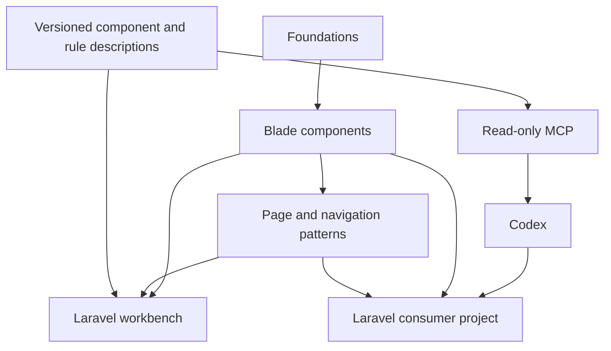

# Архитектура

## Статус

Рабочая архитектура первой реализации. Код ещё не создан. Решения отделены от требований пользователя и могут уточняться с записью основания в [журнале решений](decisions.md).

## Слои

| Слой | Отвечает за | Не владеет |
| --- | --- | --- |
| Foundations | Семантические токены, типографические роли, темы, плотность, состояния и layout-примитивы | Предметные данные и уникальная геометрия страницы |
| Components | Реальные Blade-компоненты, локальные стили, доступность и взаимодействие | Запросы к БД, ACL, маршрутизация приложения |
| Patterns | Оболочка, навигация, страницы, композиции форм/списков | Обязательные модели Order/User и соглашения о CRUD |
| Catalog | Назначение, правила выбора, сценарии, API и примеры одной версии | Самостоятельная копия HTML компонентов |
| Workbench | Laravel-среда живого каталога и синтетических страниц | Production-база и скрытая зависимость от референса |
| MCP | Чтение версионированных знаний и ссылок на примеры | Изменение приложения, запуск проверок и выбор за агента |
| Codex integration | Порядок поиска/выбора компонентов и соблюдения правил | Гарантия безошибочного дизайна и обход политик проекта |



## Размещение

Один самостоятельный репозиторий AesteticUi. Первоначально не нужны отдельные репозитории и пакеты для каждого слоя. Предполагаемые области будущей реализации:

```text
AesteticUi/
  AGENTS.md
  README.md
  docs/
  catalog/                 # описания, правила, сценарии, версии
  src/                     # Laravel provider, support и binding
  resources/
    views/components/
    css/
    js/
    icons/
  config/
  lang/
  dist/                    # будущая поставка готовых ассетов
  workbench/               # живой Laravel-каталог
  tools/mcp/               # адаптер чтения каталога
  tests/
```

Сейчас существуют только документы, начальный JSON-каталог и служебные файлы проекта. Остальные каталоги выше — план, не результат реализации.

## Первая техническая база

- Laravel/Blade; исходная целевая среда Laravel 12 / PHP 8.3. Это стартовая граница, не подтверждённая матрица совместимости. Расширение версии framework определяется потребностями проектов.
- Рабочие идентификаторы: Composer `aestetic/ui`, namespace `Aestetic\Ui`, Blade `<x-ui::button>`, CSS `.aui-*` и `--aui-*`. Доступность публичных имён не проверялась.
- Anonymous views по умолчанию; PHP-класс для самостоятельной нормализации/связывания данных. Не создавать пустой класс на каждый шаблон.
- Собственный CSS на семантических переменных; потребителю не требуется наследовать конфигурацию Tailwind. Локальный reset ограничен компонентами/областью библиотеки.
- Небольшие ES modules. Не наследовать обязательную связку Alpine/jQuery/Select2. Уникальные IDs, идемпотентная инициализация, cleanup и изоляция экземпляров.
- Темы light/dark/system и обычная/компактная плотность. Доступный focus обязателен; конкретное визуальное выражение выбирается в собственной системе, а не наследует частные запреты референса.
- Потребитель устанавливает Composer-пакет с готовыми CSS/JS. Источники и сборка библиотеки живут здесь. Точные build-зависимости фиксируются при каркасе, без заявления совместимости заранее.

## Доставка

Планируется пакетная поставка готовых CSS/JS с manifest и хешами. Laravel provider регистрирует компоненты и публикацию ассетов в выделенную vendor-область public. Обновление пакета и соответствующих ассетов — единая описанная операция. Точные теги/пути определяются в каркасе.

Каталог и MCP — инструменты разработки; их web/server runtime не становится обязательной частью production-приложения. MCP может читать установленные метаданные без постоянно запущенного визуального каталога.

## Единые знания и фактический API

1. Код компонентов определяет реальную семантику и поддержку props/slots.
2. Версионированное описание хранит назначение, ограничения, альтернативы и правила композиции. Таблицы API дополняются только вместе с реализацией.
3. Stories/scenarios рендерят реальные Blade-компоненты. Каталог не рисует независимо похожие элементы.
4. Каталог и MCP используют одни и те же сведения. Документация API не поддерживается второй ручной таблицей отдельно от реестра.
5. Согласованность кода и метаданных должна получать функциональные свидетельства в разрешённом объёме. Она не объявляется автоматически гарантированной от наличия JSON.

Не внедрять на старте большой генератор кода или парсер всего Blade. Сначала нужен короткий реальный путь от одного компонента до каталога и ответа MCP; автоматизацию расширять при подтверждённой необходимости.

## Границы основных контрактов

- Button и Link сохраняют нативную семантику. Иконка не заменяет доступное имя. Loading и disabled различаются.
- Field владеет label/hint/error/ARIA; контрол получает значения явно. Laravel binding обрабатывает old/errors и вложенные имена согласованно, без скрытого чтения моделей.
- Page/Section/FormSection задают смысловые интервалы и роли заголовков; пользователь компонента не вычисляет их заново в каждой странице.
- Navigation получает дерево разрешённых пунктов/ссылок/состояний. Построение дерева доступа и текущего route принадлежит приложению.
- Table получает строки/слоты, готовые ссылки сортировки и данные пагинации. Фильтры не строят SQL. Выбор всех строк по умолчанию относится к видимой странице.
- Dialog/Menu/Tabs имеют клавиатурный и focus-контракт, отдельно от оформления.
- Файловые контролы не принимают решения об ownership и storage. Сетевые операции остаются у потребителя.
- Нативные формы/ссылки работают без JS; критичные операции имеют согласованный путь подтверждения.

## Версии

Раздельно версионируются формат каталога, содержимое каталога и релиз библиотеки. Нельзя подставить latest вместо установленной версии молча. Planned/experimental/deprecated статусы видны и человеку, и агенту.

API первой 0.x версии ещё не стабилен. Несовместимое изменение требует описания миграции и новой minor-версии; patch не должен скрыто ломать установленный контракт.
