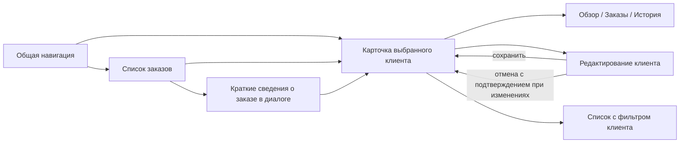

# Этап 1: навигация и три эталонных экрана

Дата: 23 октября 2026 года.

## Статус

Подготовлены исходники кликабельного дизайн-прототипа и проектные правила направления. Открытие: [design/reference/index.html](../design/reference/index.html), инструкция — [README прототипа](../design/reference/README.md).

Браузер, тесты, сборки и другие проверочные запуски не выполнялись. Визуальная приёмка пользователя ожидается. Этап не отмечается принятым до согласования направления. Реальные Blade-компоненты, Laravel-workbench и MCP не созданы; каталог семейств остаётся `planned`.

## Направление

Сдержанная рабочая среда: светлая боковая колонка, графитовый текст, мягкий нейтральный фон, белые поверхности и небольшой синий акцент. Основной контент важнее декора. Отсутствуют внешние шрифты, изображения, зависимости и дополнительные dashboard-карточки над каждым списком.

Эти решения — проектное предложение для просмотра, не постоянные требования пользователя. Цвета, размеры и геометрия могут уточняться после визуальной приёмки.

## Информационная архитектура

- Глобальная навигация выбирает предметный раздел. «Клиенты» раскрывает три синтетических профиля, чтобы не добавлять четвёртый экран списка клиентов на этом этапе. В реальном продукте список/поиск клиентов будет отдельным сценарием.
- Breadcrumbs показывают положение; несуществующие родительские экраны не изображаются кликабельными ссылками.
- Вкладки меняют представление одного клиента, не глобальный раздел. Быстрые статусы над таблицей являются фильтрами с `aria-pressed`, а не вкладками.
- Основная кнопка списка — «Создать заказ». Экспорт вторичен. В карточке основной переход — редактирование; в форме — сохранение.
- Возврат из карточки сохраняет настройки списка в памяти страницы. Ссылка «Все заказы» добавляет явный фильтр клиента.
- На мобильном глобальная навигация переносится в dialog с сохранением подписей и структуры; отдельного меню плиток нет.

## Экран 1. Список заказов

Композиция: Page → PageHeader → быстрые фильтры → FilterBar → Table → Pagination.

В заголовке — название и количество записей в области текущего клиента. Глобальный счётчик в навигации показывает все заказы. Поиск работает по номеру, клиенту, email, компании и названию позиции. Расширенные фильтры содержат статус и даты; применять некорректный диапазон нельзя.

Сортировка относится к сумме/дате. Checkbox в заголовке выбирает только видимую страницу. Массовое действие появляется после выбора. Отмена и повторное применение фильтров очищают выбор, чтобы скрытые записи не участвовали неожиданно.

Таблица сохраняет существенные колонки на узкой ширине и получает доступную горизонтальную прокрутку. Макет не заявляет окончательную реализацию mobile-table библиотеки.

## Экран 2. Карточка клиента

Композиция: Page → контекст возврата → PageHeader → PageLayout → Tabs/Sections + ContextPanel.

Обзор содержит контакты, адрес, заметку и последние заказы. Боковая панель содержит небольшую сводку и метаданные. На узкой ширине она следует за основным содержимым.

Вкладки — Обзор, Заказы, История. Стрелки и Home/End задают переключение внутри tablist; связь tab/panel задаётся явно. История синтетическая, не серверный audit log. Изменение профиля обновляет верхнюю демонстрационную запись, но не создаёт доказанный журнал операций.

## Экран 3. Форма редактирования

Композиция: Page → PageHeader → Form → FormSection → FieldGroup → Field → FormActions.

Три смысловых раздела: Основное, Адрес доставки, Дополнительно. Подпись располагается над контролом, подсказка и ошибка связаны с ним. Обязательны имя и email; остальные поля имеют явную нативную семантику. При ошибке есть общий список и сообщение у поля.

Сохранение недоступно до изменения значений. Статус несохранённых изменений расположен рядом с действиями, не заменяет подпись кнопки. Отмена и смена экрана требуют выбора при наличии черновика. После сохранения показывается карточка с обновлёнными локальными данными.

Дополнительная панель формы показывает её разделы на достаточно широком экране. На узком она скрывается: обязательные поля и действия остаются в основной форме. Нижняя панель действий закрепляется в контексте формы, а не над всеми экранами.

## Исходные визуальные роли

| Роль | Предложение прототипа | Владелец |
| --- | --- | --- |
| Базовый интерфейсный текст | 14px; подписи данных 12–13px | Тема / компонент |
| Заголовок страницы | 25–30px, semibold, один h1 | PageHeader |
| Заголовок раздела | 16px, semibold | Section / FormSection |
| Label → control | 8px | Field |
| Control → hint/error | 7px | Field |
| Поля одной группы | 22px по вертикали, 20px по горизонтали | FieldGroup |
| Обычный контрол | 40px desktop, не менее 44px в мобильной композиции | Control / responsive |
| Компактный контрол | 36px desktop; мобильная цель не уменьшается | Тема density |
| Заголовок секции → содержимое | 22–25px | Section |
| Разделы формы | 20px между поверхностями | Form |
| Основная область → context panel | 20–28px | PageLayout |
| Keyboard-focus | Различимый outline с отступом | Общая основа |

Это исходные значения макета, а не окончательный token API. Уникальная геометрия остаётся в композиции. Размер глифа checkbox и размер области нажатия различаются; при переносе в библиотеку необходимо сохранять удобный hit target.

## Состояния и адаптация

Параметры макета позволяют показать light/dark, comfortable/compact, normal/empty/error/loading. Это управление просмотром, не реальные сетевые статусы. Удаление вымышленных данных не требуется для просмотра пустоты.

На ширине до 760px используется drawer навигации; при нехватке ширины контекстная панель переносится вниз, поля переходят в одну колонку. Границы выбраны по композиции, а не считаются универсальными breakpoint-токенами библиотеки.

## Что обсудить после просмотра

1. Подходит ли характер оформления и баланс свободного пространства/плотности?
2. Удобно ли разделение глобальной навигации и вкладок объекта?
3. Понятно ли основное действие в списке, карточке и форме?
4. Нужна ли боковая панель в таком объёме?
5. Сохраняется ли читаемость в тёмной/компактной и мобильной композициях?

## Переход в этап 2

После согласования направление переносится в реальные Blade-компоненты, их сценарии и versioned registry. Живой каталог строится из этих компонентов. Файлы `design/reference/` остаются артефактом этапа проектирования и не становятся вторым поддерживаемым renderer библиотеки.
